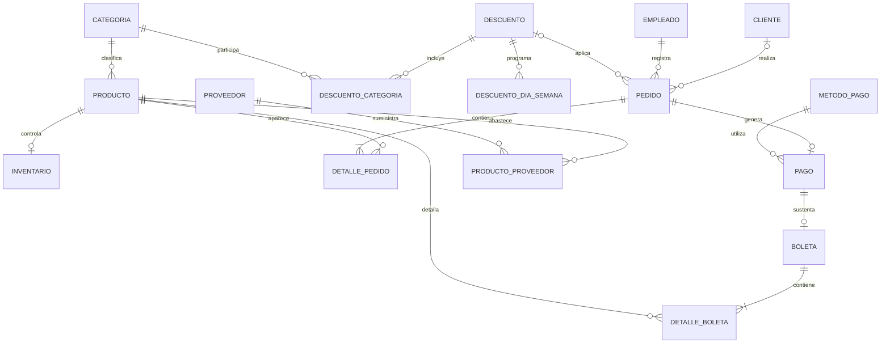

# Modelo relacional - AMASAE Cafetería

## Entidades principales
- categoria: clasificacion del menu.
- producto: bebidas, postres, tortas, sanguches y otros productos.
- cliente: datos de clientes y consumidores identificados.
- empleado: personal que registra las ventas.
- pedido y detalle_pedido: cabecera y lineas de una venta.
- pago y metodo_pago: cobro y medio utilizado.
- boleta y detalle_boleta: comprobante y productos incluidos.
- inventario: existencias y niveles de reposicion.
- proveedor y producto_proveedor: abastecimiento.
- descuento, descuento_categoria y descuento_dia_semana: promociones.
