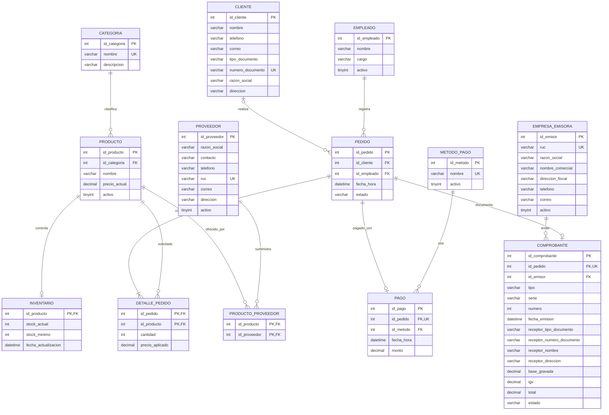

# Modelo relacional Amasae V2 (13 tablas)

**Origen:** 11 tablas de los scripts del ZIP de Amasae + las nuevas tablas
`empresa_emisora` y `comprobante`. Los clientes y proveedores tienen atributos
nuevos de documento, dirección y contacto.

**Observación:** El EER generado desde MySQL Workbench es la referencia para la
implementación física. El diagrama anterior es una guía textual editable; no es
un archivo `.mwb` y no sustituye la ingeniería inversa de Workbench.
